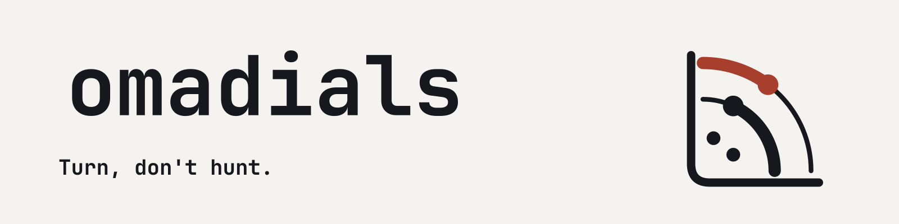
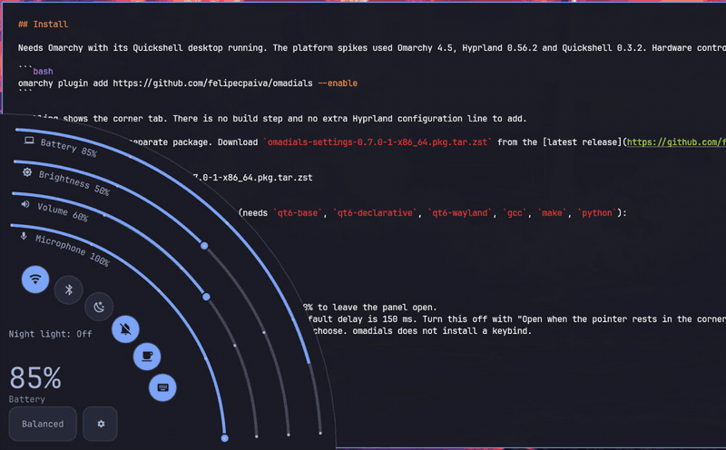
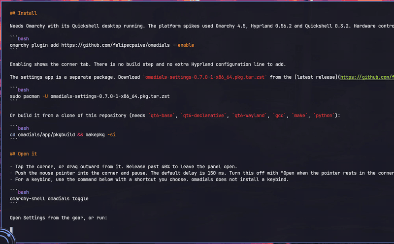
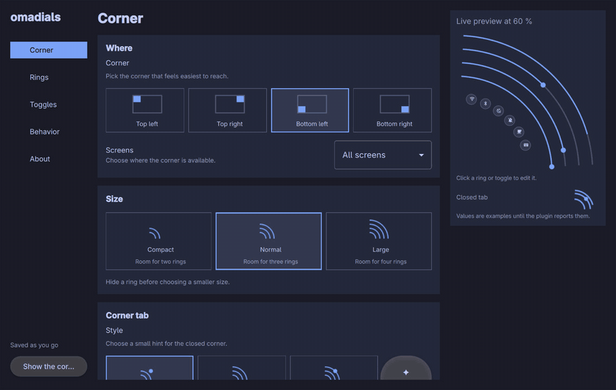
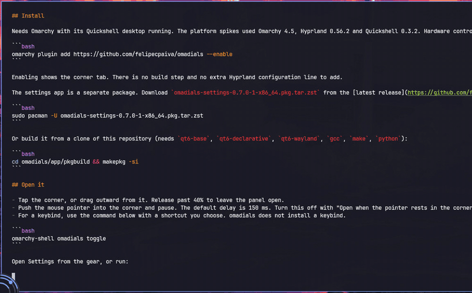

<p align="center">
  <picture>
    <source media="(prefers-color-scheme: dark)" srcset="branding/social/banner-dark.png">
    
  </picture>
</p>

# omadials

Quick settings as you drag or tap from a screen corner.

A corner panel for [Omarchy](https://omarchy.org), with rings for brightness, volume and microphone level, and quick toggles beside them.

**Status:** v0.7.0, the first public release. It is used daily on one laptop (an ASUS ROG Flow Z13). What comes next is in the [roadmap](docs/ROADMAP.md); the open limits are listed below.

## What it does

- Drag a ring to adjust brightness, volume or microphone level. Scroll or use the keyboard for small changes. Brightness stops at 1%. Volume is capped at 100% by default, with a 150% option.
- Tap toggles for Wi-Fi, Bluetooth, night light, do not disturb, keep awake and keyboard light. Scroll the arc for airplane mode, game mode, theme and media controls.
- Hold a control to open its details. Details include Wi-Fi networks, Bluetooth devices, mute, power profiles, installed themes and media playback. Some detail actions are still incomplete; see Known limits.
- A small corner tab marks where to open it. Choose two rings and a knob, three rings, or your own icon, and make it smaller if you like. The colours follow your Omarchy theme.
- A battery ring shows how much battery is left, in the closed tab and in the open corner. It turns red at a level you choose (20% by default) when the laptop is not charging.
- Open Settings from the gear in the corner, or run `omarchy-shell omadials settings`. Both open the omadials-settings app (see Install).







## Install

Needs Omarchy with its Quickshell desktop running. The platform spikes used Omarchy 4.5, Hyprland 0.56.2 and Quickshell 0.3.2. Hardware controls depend on the tools and services listed below.

```bash
omarchy plugin add https://github.com/felipecpaiva/omadials --enable
```

Enabling shows the corner tab. There is no build step and no extra Hyprland configuration line to add.

The settings app is a separate package. Download `omadials-settings-0.7.0-1-x86_64.pkg.tar.zst` from the [latest release](https://github.com/felipecpaiva/omadials/releases/latest), then install it:

```bash
sudo pacman -U omadials-settings-0.7.0-1-x86_64.pkg.tar.zst
```

Or build it from a clone of this repository (needs `qt6-base`, `qt6-declarative`, `qt6-wayland`, `gcc`, `make`, `python`):

```bash
cd omadials/app/pkgbuild && makepkg -si
```

## Open it

- Tap the corner, or drag outward from it. Release past 40% to leave the panel open.
- Push the mouse pointer into the corner and pause. The default delay is 150 ms. Turn this off with "Open when the pointer rests in the corner".
- For a keybind, use the command below with a shortcut you choose. omadials does not install a keybind.

```bash
omarchy-shell omadials toggle
```

Open Settings from the gear, or run:

```bash
omarchy-shell omadials settings
```

`omarchy-shell omadials open` and `omarchy-shell omadials close` also work. `omarchy-shell omadials status` returns control state and configuration errors as JSON.

Click outside to close. That click is consumed. Escape goes back from a detail, then closes when the panel has keyboard focus. The corner trigger is hidden on fullscreen outputs and while locked. Its small tap zone takes clicks even when the tab sits behind a window.

## Settings

- **Corner:** any of the four corners. Choose which outputs have a trigger.
- **Size:** Compact (S), Normal (M) or Large (L). They fit up to 2, 3 or 4 rings. Screen size can reduce the space available. Extra toggles scroll along the arc.
- **Corner tab:** always visible, visible on approach, or never visible. Put it above or behind windows. Use the default tab, an icon theme name, or a local SVG or PNG. Tab size from 50% to 100%. The tap zone has its own switch.
- **Battery:** show the battery ring (on by default; the open corner grows by one ring for it) and the level at which it turns red (5% to 50%).
- **Controls:** show or hide each control, pick its icon and change its order. Choose the tap and hold actions offered for that control. Actions come from a fixed list, not custom commands.
- **Ring styles:** solid, dashed, dotted or segmented tracks; round, bar or no knob; thin, normal or bold lines. Set defaults and per-ring overrides.
- **Display rings:** Bluetooth device battery, Wi-Fi signal, laptop battery or pen battery. These show values without adjusting them. They count toward the ring limit. Missing data is shown as unknown or not connected.
- **Behaviour:** rest to open and its delay, close after a time, close on pointer leave, fine adjustment, snap, volume cap, the open animation (six styles, speed, bounce) and what game mode turns off. omadials follows the active Omarchy theme; the theme toggle opens the list of installed themes.

Settings live in `~/.config/omadials/config.json`. The store watches for edits and preserves unknown keys when changing a setting. Invalid JSON and newer configuration versions open read-only. Reset all can replace the file with defaults.





## Commands it runs

These are the commands started by the plugin code, including its backends and recovery helper. Angle brackets mark one argument supplied by the control. Alternatives separated by `|` are separate choices. Commands use argument arrays, without a shell.

| Control | Commands |
|---|---|
| Brightness | `brightnessctl -m -d <device>`; `omarchy-brightness-display --no-osd <1..100>%`, with optional `--monitor <monitor>` before the percentage. Default read device: `amdgpu_bl1`. |
| Microphone mute | `omarchy-audio-input-mute` |
| Wi-Fi | `nmcli radio wifi <on|off>`; `nmcli con up <network-name>` for a saved network |
| Bluetooth | `omarchy-bluetooth-power <on|off>` |
| Night light | `omarchy toggle nightlight --status`; `omarchy toggle nightlight` |
| Do not disturb | `omarchy-shell notifications isDnd`; `omarchy toggle notification silencing` |
| Keep awake | `omarchy toggle idle status`; `omarchy toggle idle <stay-awake|allow-idle>` |
| Keyboard light | `brightnessctl -m -d <device>`; `brightnessctl -d <device> set <level>`. Default device: `asus::kbd_backlight`; default configured maximum: 3. |
| Power profile | `powerprofilesctl get`; `omarchy-powerprofiles-list`; `omarchy-powerprofiles-set autodetect <performance|balanced|power-saver>` |
| Airplane mode | `rfkill -J`; `rfkill event`; `rfkill block all`; `rfkill unblock <saved-radio-id>`. Bluetooth restore uses `omarchy-bluetooth-power on`. Only previously unblocked radios are unblocked. |
| Themes | `omarchy-theme-current`; `omarchy-theme-list`; `omarchy-theme-set <installed-theme-name>` |
| Pen battery | `upower -i <UPower-device-object-path>` |
| Game mode | `hyprctl -j getoption <option>` for `animations:enabled`, `decoration:blur:enabled`, `decoration:shadow:enabled`, `general:gaps_in` and `general:gaps_out`; `hyprctl eval <generated-hl.config-expression>` to apply or restore those five runtime values |
| Game recovery | `qs -d -n -p <plugin>/controls/gamemode/Recovery.qml`; `qs ipc -p <plugin>/controls/gamemode/Recovery.qml call recovery ready` |
| Folders and cleanup | `mkdir -p <HOME>/.config/omadials`; `mkdir -p <state-dir>`; `mkdir <state-dir>/game-restore.lock`; `rm -- <state-dir>/airplane-restore.json`; `rm -- <state-dir>/game-restore.json`; `rmdir <state-dir>/game-restore.lock` |

`<state-dir>` is `$XDG_STATE_HOME/omadials`, or `~/.local/state/omadials` when that variable is unset.

Not every control needs a command. Quickshell talks to PipeWire for volume, microphone level and output mute; NetworkManager for network discovery and open-network connections; BlueZ for Bluetooth devices and connections; UPower for battery readings; and MPRIS for media players. The plugin also uses Hyprland events and monitor state. These service operations can change system state without starting a command.

## Files it reads or writes

This lists direct data-file access by the plugin. Its bundled QML, JavaScript, catalog and artwork are also loaded from the plugin folder. Stock commands and system services manage their own files, such as saved network connections and the selected Omarchy theme; those indirect effects are not limited to this table.

| Path | Access and purpose |
|---|---|
| `~/.config/omadials/config.json` | Read, watch and write settings. Atomic saves use a temporary sibling file and rename it. The service creates the parent folder. |
| `<state-dir>/airplane-restore.json` | Read and atomically write the saved radio soft-block states before enabling airplane mode. Delete after a verified restore. |
| `<state-dir>/game-restore.json` | Read, watch and atomically write the compositor identity, shell process identity, baseline and intended game values. Delete after verified recovery, or when its compositor instance is gone. Atomic saves use a temporary sibling file. |
| `<state-dir>/game-restore.lock/` | Create and remove a directory used as the game session lock. |
| `/proc/<shell-pid>/stat` | Read the shell process identity so the game recovery helper can detect its exit or a reused process ID. |
| `~/.local/state/omarchy/indicators/stay-awake` | Read/watch the stock keep-awake indicator. |
| `~/.local/state/omarchy/notifications/quiet.json` | Read/watch the stock do-not-disturb state. |
| `~/.local/state/omarchy/current/theme.name` | Read/watch for theme changes. Theme colours come from the shell's theme service. |
| `<plugin>/controls/catalog.json` | Read the control catalog. |
| Your selected local corner icon and installed icon theme assets | Read to draw icons. |

The architecture proposes migration backups named `config.v<N>.bak`. The current `ConfigStore.qml` does not create them. Do not rely on an automatic backup.

## What it never does

- It never changes the bar or writes `shell.json`.
- It never edits your Hyprland configuration. Game mode writes runtime values only, through `hl.config`, and journals the values needed to restore them. It does not reload Hyprland.
- It makes no network requests of its own. Wi-Fi controls ask NetworkManager to scan or connect when used.
- It never asks for root or runs `sudo`.
- It never runs commands supplied in its settings file.

## Known limits

- Screen readers cannot read Quickshell layer surfaces yet on the tested Quickshell 0.3.2 build. Spike S4 found no accessible children through AT-SPI. Accessible names remain in the code, but they do not solve this platform limit. See [spike results](docs/spikes.md).
- Inline Wi-Fi passwords are off until S7 verifies secure password handling. New secured networks request the full stock window instead. The backends emit that request, but the current code does not wire it to a window launcher. Use Omarchy's network settings for now. Bluetooth's full-window action has the same wiring gap.
- The touchpad and touchscreen toggles are in the default list but stay at "probing" on the tested machine. A recording toggle comes later. Existing touchpad swipes are left alone.
- Audio device pickers, per-app sliders and custom media details are being integrated. Their complete behaviour still needs verification. Display refresh and scale controls are not wired into the brightness detail. External-monitor brightness reads are currently unavailable in the brightness backend.
- The spike checks did not verify MPRIS with a running player. Keyboard focus after IPC opening, first-open compositor timing and the full acceptance checklist still need hand checks.
- Game mode has a recovery helper and read-back checks in code. The complete forced-exit, logout and failure recovery checklist has not been verified by this README task. Restore game mode and airplane mode before removing the plugin or deleting their journals.

## Uninstall

First turn off game mode and airplane mode so their saved state can be restored. Then run:

```bash
omarchy plugin remove io.github.felipecpaiva.omadials
```

Settings are kept in `~/.config/omadials/`. Delete that folder if you also want to forget your settings. The state folder is separate: `<state-dir>`. Keep any restore journal until recovery succeeds; do not delete it as ordinary settings cleanup.

## Licence

MIT. See [LICENSE](LICENSE). See [branding/README.md](branding/README.md) for artwork and font licence notes.

Not affiliated with or endorsed by Omarchy.

## For contributors

| Doc | What it holds |
|---|---|
| [docs/ROADMAP.md](docs/ROADMAP.md) | What comes after v0.7.0, and the known gaps |
| [docs/plan.md](docs/plan.md) | The plan: phases P0 to P10, day goals, what done means |
| [docs/architecture.md](docs/architecture.md) | Start here: layers, control contract, config, milestones |
| [docs/experience.md](docs/experience.md) | Motion and interaction spec: timings, curves, state machine. Prototype: [docs/prototype/motion.html](docs/prototype/motion.html) |
| [docs/ux.md](docs/ux.md) | Experience, touch, theming, settings window |
| [docs/acceptance.md](docs/acceptance.md) | Shared acceptance checklist with stable IDs |
| [docs/controls.md](docs/controls.md) | Every hardware control: read, write, events, availability |
| [docs/platform.md](docs/platform.md) | Omarchy shell plugin contract |
| [docs/spikes.md](docs/spikes.md) | Platform checks, results and unresolved limits |
| [docs/references.md](docs/references.md) | What we learned from other control corners |
| [docs/research.md](docs/research.md) | Origin, feasibility, duplicates, decisions |
