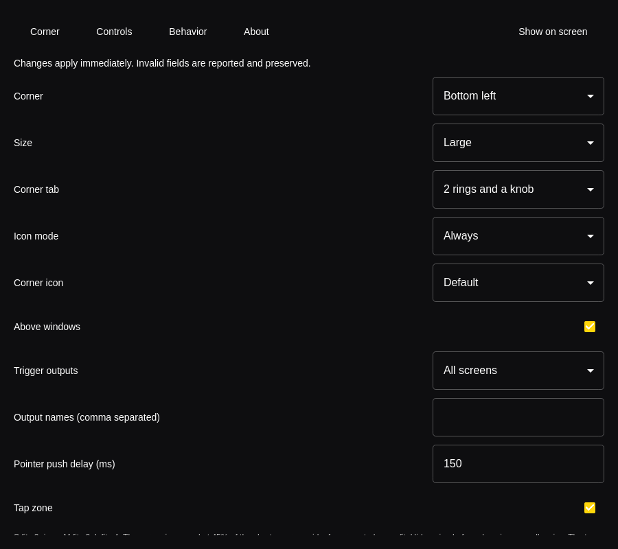

Standalone C++ and Qt Quick settings for omadials. A geometry-based layout preview follows size, corner, visibility and ring styling. Corner, Controls, Behavior and About match the plugin panel. Changes apply immediately through the plugin's watched config file. The plugin is optional for editing; status and Show on screen need a running Omarchy shell with omadials enabled.

Build from the repository checkout:

```sh
cd app
qmake6
make
./omadials-settings
```

Requires Qt 6 base and declarative development tools, Qt Quick Controls, a C++17 compiler, make and Python 3. Wayland sessions also need qt6-wayland. `qmake6` copies the current `../logic/{ConfigSchema,ConfigMigrate,Labels,Geometry,Layout}.js` and `../controls/catalog.json` into ignored `generated/` resources. The files are embedded unchanged in the single binary. Changes to shared logic or catalog cause qmake to run again on the next make. Do not edit generated files. QML pages are local adaptations of the plugin settings UI; no Quickshell imports are required.

To build an Arch package and install it yourself:

```sh
cd app/pkgbuild
makepkg
sudo pacman -U ./omadials-settings-0.7.0-1-*.pkg.tar.zst
```

The PKGBUILD uses this local source checkout, including the parent logic and catalog. It is not a standalone release-source PKGBUILD. It installs the binary, desktop entry, icon and license. No package was installed during development.

Writes only `~/.config/omadials/config.json` on edits, reset and Undo. Missing files use defaults in memory. The directory is created on the first edit. Writes use QSaveFile with no direct-write fallback, re-read the latest disk text, patch only the edited paths and preserve unknown keys. A compare-before-write check refuses detected concurrent edits. Like the plugin, two simultaneous writers can still race between checking and renaming. Explicit Reset all replaces the whole file, including unknown keys, and offers Undo for 10 seconds. Newer versions cannot be reset. Malformed JSON keeps the previous usable view and is read only until repaired or explicitly reset. Undo restores the previous text; undoing the first edit leaves a default file rather than deleting it. External edits cancel Undo. Schema v1 has no predecessor migrations; unsupported older versions remain read only.

Theme accent and Hyprland rounding follow the Omarchy app recipe live. Other surfaces use the recipe's dark Material style. No Omarchy configuration is written. English UI uses shared Labels.js for setting choices. Status uses only fixed `omarchy-shell omadials status` argv, and Show on screen uses only `omarchy-shell omadials open`, with a three second timeout and visible failures. No shell command strings are evaluated.

| Shortcut | Action |
|---|---|
| Ctrl+Q | Quit |
| Ctrl+Z | Undo the most recent edit within 10 seconds |
| ? | Keyboard help |
| Tab / Shift+Tab | Move through fields |

For a display-free validation report, run `./omadials-settings check --json`. It exits 0 on a clean config and 1 with JSON errors and stderr on problems. `./omadials-settings skill install --json` explicitly installs the bundled agent instructions at `~/.agents/skills/omadials-settings/SKILL.md`. The installer is the only command that writes that path. It was not run during development.

Q is reserved for text entry. Edits save immediately, so there is no unsaved form to discard.

Verification:

```sh
cd app
qmake6 && make
cd tests
qmake6 settings_tests.pro && make
./settings-tests
```

The tests set a temporary HOME before creating QGuiApplication, use offscreen software rendering and capture `tests/preview.png`. They exercise the actual QML store and all four pages, atomic file operations, unknown-key preservation, invalid edits, malformed JSON, newer-version protection, reset and Undo, concurrent-change detection external file reload, fixed-argument IPC through a fake executable, mouse navigation and live theme accent reload. The test runner never writes the real config.

Live checks still needed: compositor appearance and keyboard navigation, scrolling and dropdown interaction, installed desktop entry and icon, real plugin file-watch latency, IPC availability/reason reporting and Show on screen, and a desktop theme/symlink switch including Hyprland rounding. Do these only when the desktop is free for testing.
