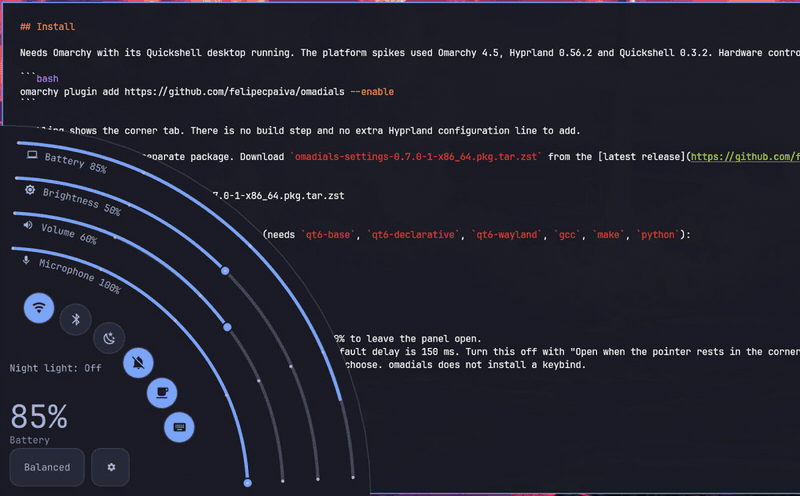
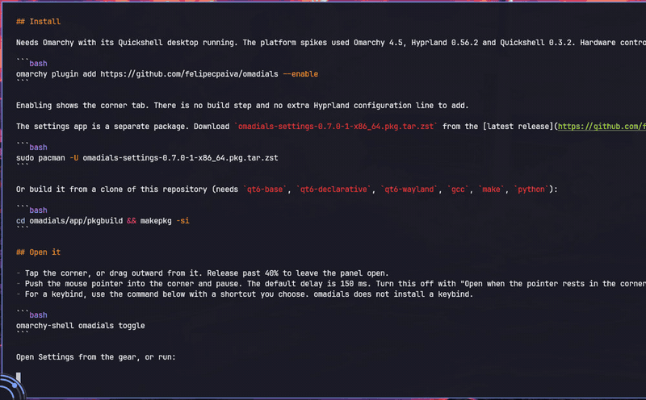
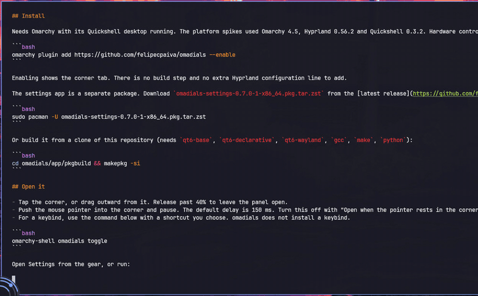
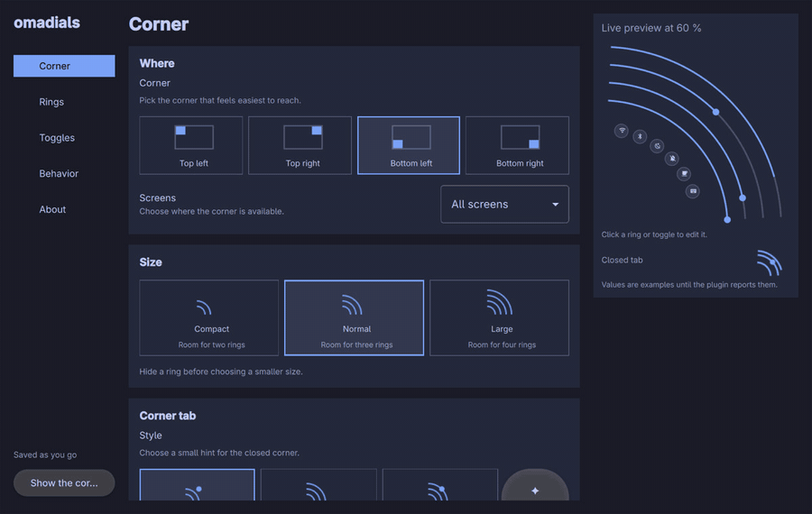

# omadials v0.7.0

The first public release. A quarter-circle quick settings corner for Omarchy: rest the pointer in a screen corner,
tap it or drag from it, and set brightness, volume and mic on rings, with toggles beside them. A separate settings app
comes with it. Everything follows the active Omarchy theme.


What is in it:

- **Rings** for brightness, volume and mic. Drag to set, move away from the ring for fine control, snap to 0, 25, 50,
  75 and 100 %, scroll for small steps.



- **A toggle arc** for Wi-Fi, Bluetooth, night light, do not disturb, keep awake, keyboard light, airplane mode, game
  mode, theme and media, plus the battery and power profile readout. Slide the arc for more. Hold a toggle for its details (networks, devices, audio
  outputs, installed themes and more).


- **A battery ring,** the outermost ring in the closed tab and in the open corner, red at a level you choose (20 % by
  default) when the laptop is not charging. **A tab size** setting from 50 to 100 %.



- **Six open styles** (Tab morph, Hybrid, Lens, Spring cascade, Minimal, Fan), each with speed and bounce. Every style
  opens out of the closed tab and closes back into it.



- **The settings app** (`omadials-settings`): Corner, Rings, Toggles, Behavior and About pages, a live preview of the
  corner, undo and reset. It is a C++ and Qt Quick app, installed as an Arch package.



What was tested:

- The plugin suite (`bash test/run-all.sh`) and the app tests (`app/tests`), on the Z13 with Omarchy and Hyprland.
- A settings sweep that changes every setting the way a click does and reads the saved file back: all writes pass in
  a dark and two light themes, with page shots at full and narrow width
  ([settings-validation.md](../settings-validation.md)).
- A live pointer check (`test/live/run-p5.sh`) for rest to open, the tap zone and close on leave. It found and fixed
  a bug where the corner closed itself 0.6 s after opening by rest.
- Fixed before this release: five settings that saved but did nothing, ring styles that never reached the default
  rings, game mode switches that forced values, and unreadable text on light themes in the settings app.

Known limits:

- The "Screens" setting was never tried on a second monitor.
- Screen readers cannot read Quickshell layer surfaces yet (spike S4).
- Inline Wi-Fi passwords are off; use Omarchy's network settings.
- The touchpad and touchscreen toggles stay at "probing" on the tested machine.
- The rest are in [ROADMAP.md](../ROADMAP.md) under "Known gaps".

How to install:

```bash
omarchy plugin add https://github.com/felipecpaiva/omadials --enable
```

Then install the settings app attached to this release (x86_64):

```bash
sudo pacman -U omadials-settings-0.7.0-1-x86_64.pkg.tar.zst
```

What comes next is in [ROADMAP.md](../ROADMAP.md).
